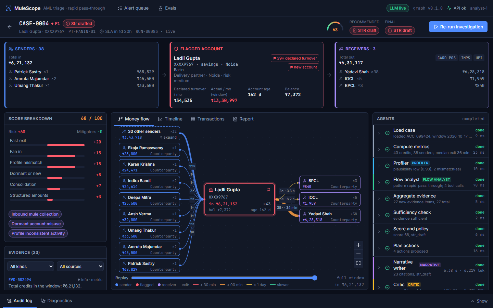
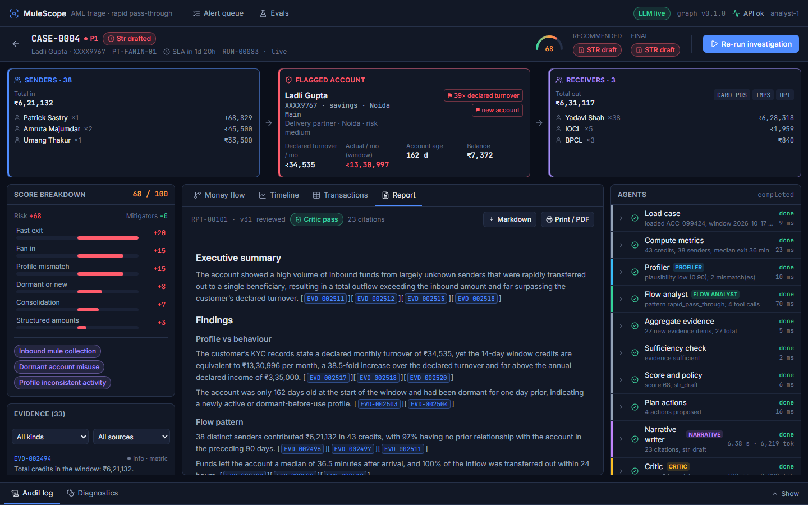
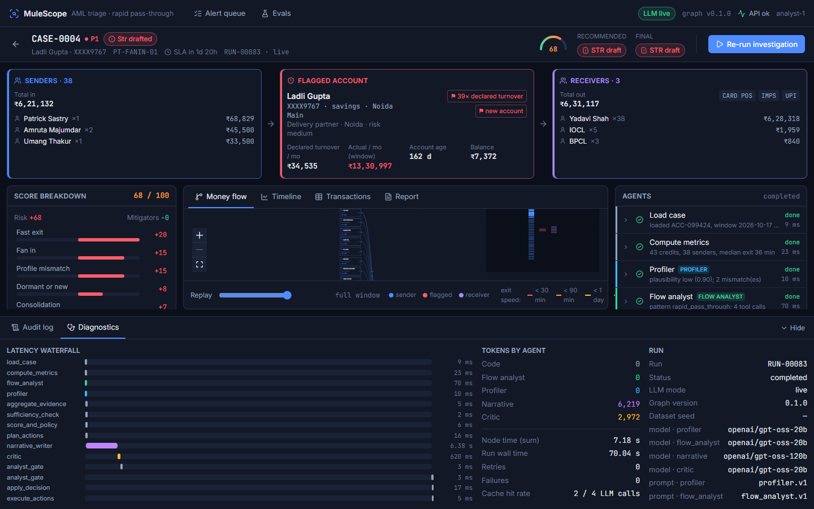

# MuleScope

An AML triage copilot for mule accounts and rapid pass-through activity.

Mule accounts receive money from many unrelated senders and move it on within minutes, which hides where stolen or laundered funds go. MuleScope takes a detector alert, investigates the account with LangGraph agents, scores it, recommends Close, Escalate or STR draft, and waits for an analyst to decide. The metrics, the score and the disposition are plain deterministic code; the AI agents only investigate and write, and only a human can override the policy.

All data in this project is synthetic: generated customers, accounts and transactions with planted scenarios. There is no real customer or bank data.



## Highlights

- Deterministic policy: nine risk signals and four mitigators from `config/scoring.yaml` produce a 0-100 score and the disposition. No LLM decides an outcome.
- Evidence-cited reports: every sentence of the narrative cites `EVD-` evidence ids, and a critic checks the citations, the stated disposition, the STR sections and the customer letter before an analyst sees it.
- Human approval gate: the run pauses at `analyst_gate` and resumes on the analyst's decision from a MongoDB checkpoint, also after an API restart.
- Tamper-evident audit trail: every graph step and decision is appended to a per-case SHA-256 hash chain that the UI verifies.
- Realistic synthetic data with hidden ground truth: persona-driven Indian banking data (UPI, IMPS, NEFT, ATM, wallets) with 40 planted alerts whose labels live in a separate database the API never opens.

## A case, end to end

1. The alert queue lists every case the detector opened, with priority, window inflow, sender count, score, recommendation, SLA and status.

   

2. Opening a case shows who sent the money, which account is flagged and where the money went, next to the score breakdown and the money-flow graph.

   

3. Starting an investigation runs the graph live, and the Agents panel shows each node's status, latency and tokens as it finishes.

   

4. The Report tab shows the generated summary, findings and draft STR narrative, with each claim cited as an EVD chip that shows its evidence on hover.

   

5. The analyst approves, edits, overrides or rejects, then handles each proposed action, and every step lands in the audit log with a verified hash chain.

   

6. The Diagnostics drawer shows the latency of each node, tokens by agent, models, prompt versions and any fallback reason.

   

7. The Evals page compares runs of all 40 planted alerts with the hidden ground truth.

   

## Tech stack

Python 3.12 and uv, FastAPI, Pydantic v2, LangGraph with a MongoDB checkpointer, MongoDB 7 (PyMongo async), Groq (`openai/gpt-oss-20b` and `openai/gpt-oss-120b`), React 19, Vite, TypeScript, Tailwind, TanStack Query, React Flow and Recharts.

## Architecture

```
                 React UI (Vite, :5173)
   queue · case workspace · money flow · agents · actions · audit · evals
                 |  REST /api/v1            ^  SSE /runs/{id}/stream
                 v                          |
+------------------------- FastAPI (:8000) ---------------------------+
|  api/routers (thin)  ->  services  ->  repositories (one per coll.) |
|                            |                                        |
|                            v                                        |
|   LangGraph case graph (compiled once, Mongo checkpointer)          |
|   load_case -> compute_metrics -> [profiler || flow_analyst]        |
|     -> aggregate_evidence -> sufficiency_check (max 1 loop)         |
|     -> score_and_policy -> plan_actions -> narrative_writer         |
|     -> critic (max 1 loop) -> analyst_gate [INTERRUPT]              |
|     -> apply_decision -> execute_actions (mock) -> finalize         |
|                                                                     |
|   domain/ (pure): metrics, signal registry, scoring, policy,        |
|                   typologies, action planner      <- config/*.yaml  |
+---------------------------------------------------------------------+
                 |
                 v
   MongoDB `mulescope` (operational)       MongoDB `mulescope_truth`
   accounts, transactions, alerts,         ground_truth only. Opened by
   cases, evidence, reports, actions,      `uv run seed` and `uv run evals`,
   audit_logs (hash chain), runs,          never by the API or agents.
   node_executions, eval_runs, ...
```

LangGraph orchestrates the run: it holds the case state, runs the profiler and flow analyst in parallel, caps the two loops, pauses at the analyst gate and checkpoints every step in MongoDB. Every node is wrapped by one decorator that writes a `node_executions` row, appends an audit event and publishes a live event to the UI.

The four LLM nodes (profiler, flow analyst, narrative writer, critic) call Groq through the project's own client. It applies a 20 s limit per call, 2 attempts and 40 s per node, a global semaphore of 2, JSON output validated by Pydantic, and an `llm_cache` collection. Transaction remarks reach a model only inside `<untrusted_data>`. On any failure a node uses its deterministic template and records the reason, so a run never fails because of an LLM. Gemini can be selected per agent in `config/llm.yaml` with no code change.

## Scope

In scope: mule and rapid pass-through alerts, alert detection, case queue, the investigation graph, deterministic scoring and disposition, action planning with a mock executor, analyst approval, the audit trail, diagnostics, report export and evals.

Out of scope: card fraud, account takeover, phishing, sanctions screening, real-time blocking, real bank integrations and real customer data.

## Setup (PowerShell)

Requirements: Python 3.12, [uv](https://docs.astral.sh/uv/), Node.js 20.19+ or 22.12+ and MongoDB 7 (Atlas, or local with `docker compose up -d`).

```powershell
uv sync
Copy-Item .env.example .env      # set MONGO_URI and MONGO_TRUTH_URI; GROQ_API_KEY only for live mode
cd frontend
npm install
Copy-Item .env.example .env.local   # VITE_API_URL=http://127.0.0.1:8000
cd ..
```

There is one `.env`, in the repository root, and it is never committed. Real environment variables override it. `MONGO_URI` and `MONGO_TRUTH_URI` may point at the same cluster, because the truth data uses its own database name. `LLM_MODE=fallback` (the default) runs every agent from templates with no keys; `LLM_MODE=live` calls Groq. The API allows the UI origin through `CORS_ORIGINS`.

## Run

From the repo root, in separate terminals:

```powershell
uv run seed --seed 42 --customers 300 --reset   # generate, load and detect (about a minute on Atlas)
uv run dev                                       # API at http://127.0.0.1:8000, docs at /docs
cd frontend; npm run dev                         # UI at http://localhost:5173
```

`--reset` drops both databases, including every case, run and audit log, so stop the API first.

In the UI, open a case, press Start investigation, watch the Agents panel, review the money flow, report and actions, then press Approve, Edit, Override, Request more or Reject.

| Command | What it does |
| --- | --- |
| `uv run seed --seed 42 --customers 300 --reset` | Generate and load the dataset, run the detector, print counts and any planted account without an alert |
| `uv run seed --preview ACC-123456` | Print one account's 14-day story |
| `uv run check-policy` | Expected vs predicted disposition for the 40 planted alerts, code only |
| `uv run smoke` | One mule and one seller through the full graph with auto-approve |
| `uv run smoke --mode live` | The same with Groq (needs `GROQ_API_KEY`) |
| `uv run evals --mode fallback` | All 40 alerts through the graph; results on the Evals page |
| `uv run evals --mode live --resume` | Continue the latest unfinished live eval run, skipping evaluated cases |
| `uv run dev` | Start the API |

## Results

Policy `policy-1.0.0`, graph `0.1.0`, dataset seed 42.

**Policy only** (`uv run check-policy`, no LLM): 40 of 40 dispositions match the ground truth, and 0 mules are closed. On seed 7 with the same weights and no retuning, the result was also 40 of 40 with 0 mules closed.

**Full graph in fallback mode** (`uv run evals --mode fallback`, run EVAL-0001, template text with no LLM):

| Metric | Result |
| --- | --- |
| Disposition accuracy | 40 / 40 |
| Mules closed | 0 |
| Citation validity | 100% |
| Claim coverage | 96.4% |
| Tipping-off violations | 0 |
| Injection obeyed (injected-remark mule) | 0 |
| Latency p50 / p95 per case | 264 ms / 346 ms |

A full live eval of all 40 alerts has not been run.

**Live smoke** (`uv run smoke --mode live`): mule.classic and seller.shop each finished in under 6 s, with critic pass and no fallback nodes, on Groq `openai/gpt-oss-20b` and `openai/gpt-oss-120b`. Groq's free tier allows about 8,000 tokens per minute per model. Back-to-back live runs, especially with a critic revision loop, can hit a rate limit and fall back to templates, so space live runs about a minute apart.

How to read these numbers:

- The weights and thresholds in `config/scoring.yaml` were tuned on the seed-42 planted alerts, so the seed-42 accuracy is in-sample.
- Seed 7 comes from the same generator and scenario definitions. It is a synthetic-to-synthetic check, not evidence of performance on real bank data.
- Four of the ten seed-42 mules score just under the STR threshold of 70: ACC-375941 (mule.classic, 65), ACC-099424 (mule.classic, 68), ACC-970705 (mule.profile_mismatch, 68) and ACC-480243 (mule.victim_linked, 68). They reach STR draft only through the caution rule (within 5 points of 70 with the STR conditions met). A small change in a weight or in the data could drop them to Escalate.

## API overview

| Area | Endpoints |
| --- | --- |
| System | `GET /health`, `GET /api/v1/config/public` |
| Alerts | `GET /alerts`, `GET /alerts/{id}`, `POST /alerts/detect` |
| Cases | `GET /cases`, `GET /cases/{id}`, `POST /cases/{id}/runs`, `POST /cases/{id}/decision` |
| Case data | `/cases/{id}/evidence`, `/report`, `/actions`, `/flow`, `/timeline`, `/transactions`, `/audit/verify` |
| Runs | `GET /runs/{run_id}/stream` (SSE), `GET /runs/{run_id}/diagnostics` |
| Accounts | `GET /accounts/{id}`, `GET /accounts/{id}/summary` |
| Actions | `PATCH /actions/{id}` (approve, reject, reverse) |
| Audit, evals | `GET /audit`, `GET /evals/runs`, `GET /evals/runs/{id}` |

All routes except `/health` are under `/api/v1`. The flow endpoint returns ready-to-render nodes and edges, so the UI never aggregates ledger rows.

## Repository layout

```
backend/app/       FastAPI app
  core/            settings, container, wiring, logging, errors, config loaders
  domain/          enums, metrics, signals, scoring, disposition policy, action planner
  repositories/    MongoDB access, one class per collection, collection setup
  services/        detector, metrics, case runner, read models, action service
  agents/          profiler, flow analyst, narrative writer, critic, tools, prompts
  graph/           state, nodes, edges, builder, checkpointer
  llm/             providers, client (cache, limits, semaphore), factory
  api/             routers, schemas, error handling
datagen/           personas, counterparties, ledger builder, scenarios, writers, validation
evals/             check-policy, smoke and the eval harness
config/            scoring, playbook, scenarios and llm YAML
frontend/          React + Vite + TypeScript analyst UI
tests/             early pytest files from the scaffold spec (not maintained)
docs/              BUILD_PROMPT.md and the screenshots in docs/images
PROGRESS.md        build checklist, decisions and known gaps
```

## Configuration

Thresholds, weights, scenario parameters, model names, token limits and action rules live in `config/*.yaml`, not in code. Changing a signal weight or a playbook rule needs no code change; rerun `uv run check-policy` to see the effect on the 40 planted alerts.

## How it was built

MuleScope was built with Kiro, the AI development environment. The specification is [docs/BUILD_PROMPT.md](docs/BUILD_PROMPT.md). Most phases were built directly from it. The project scaffold and the live-mode fixes went through Kiro specs (requirements or bug analysis, design and tasks), kept in [.kiro/specs](.kiro/specs). [PROGRESS.md](PROGRESS.md) records each phase, the decisions made and why, and the known gaps.

## Known limits

- There is no separate reviewer gate for STR drafts (maker-checker); one analyst gate decides.
- Executed actions keep the evidence ids of the run that proposed them. On a later run those ids are not in the new ledger, and the UI marks them as from an earlier run. It decides this by checking the action's `run_id`, not by looking the ids up.
- An action cancelled or rejected in an earlier run still blocks a new proposal of the same type for the same target, because the idempotency key is `case:type:target`.
- The money-flow graph shows the top 8 senders and receivers by default. Expanding a side shows at most the top 24 senders and 12 receivers, because the API caps the flow data, with the rest in one "N more" card.
- A full live eval of the 40 alerts has not been run, and Groq's free-tier rate limit makes back-to-back live runs fall back.
- The flow analyst's tools are called by code; the LLM interprets their results rather than choosing tools.
- No demo GIF, light theme, keyboard shortcuts, Audit explorer or Settings screen.
- The SSE stream has no heartbeat, so the UI reconnects and refetches when a stream drops.
- The detector scans only the 14-day window ending at the dataset date. The background produces no organic alerts, so detector precision on noise is not really measured.

The full list is in [PROGRESS.md](PROGRESS.md).

## License

[MIT](LICENSE).
