# MuleScope

An investigation workspace for money-mule alerts in Indian retail banking.

I built MuleScope to explore one question: how far can AI agents help an anti-money-laundering analyst without ever being trusted to make the decision? It takes an alert about a suspected mule account, investigates it, explains what it found with evidence behind every sentence, recommends Close, Escalate or a Suspicious Transaction Report (STR) draft, and then stops and waits for a person to decide.

All data in this project is synthetic. There are no real customers, accounts or bank systems anywhere in it.


## The problem

Most online scams in India end the same way. A victim is persuaded to pay for a fake job, a fake investment or a fake parcel fee, and the money goes by UPI or IMPS into an ordinary-looking savings account. Within minutes it moves on to another account, then another, or it is withdrawn as cash. The accounts in the middle are money mules: they belong to students, gig workers or people who sold their account for a small fee, and their job is to make the money hard to follow.

Banks run rules that flag this pattern, and every alert lands in front of an analyst. For each one the analyst has to answer a few questions. Who sent the money? How fast did it leave, and to whom? Does any of this fit what the customer told the bank at account opening? Is there a fraud complaint against the account? Then they decide: close the alert, escalate it, or prepare an STR for the Financial Intelligence Unit (FIU-IND). They also have to write down why, in a way an auditor or regulator can follow later.

This work is slow and repetitive, and the hard part is not the arithmetic. It is pulling the facts together, noticing what does not fit, and writing it up clearly. At the same time, the decision itself has to be consistent and explainable. Two analysts looking at the same facts should reach the same outcome, and nobody should be able to say "the model decided".

## The idea

MuleScope splits the work along that line.

- **Code decides.** The metrics, the risk score and the recommended outcome are plain, deterministic code driven by a configuration file. The same facts always give the same answer, and every point of the score can be traced to a rule.
- **AI investigates and writes.** Four agents read the account's profile and transactions, judge whether the activity makes sense for this customer, describe how the money moved, draft the report and review that draft. Every sentence they write must cite an evidence item, and anything uncited is removed.
- **A person approves.** The investigation pauses before anything happens. The analyst can approve, edit the report, ask for more, reject the recommendation, or override it with a written reason. Only a person can change the outcome.
- **Nothing is hidden.** Every step, decision and action is written to an audit log that is chained with hashes, so tampering can be detected. Every AI call is recorded with its model, latency, tokens and estimated cost.

If the AI service is down, out of quota or returns something unusable, each agent falls back to a rule-based version of itself. The case still finishes, and the report says which steps fell back and why.

## A case, from alert to decision

The alert queue lists every case the detector opened, with its priority, the money that came in during the 14-day window, the number of senders, the score, the recommendation, the deadline and the status.

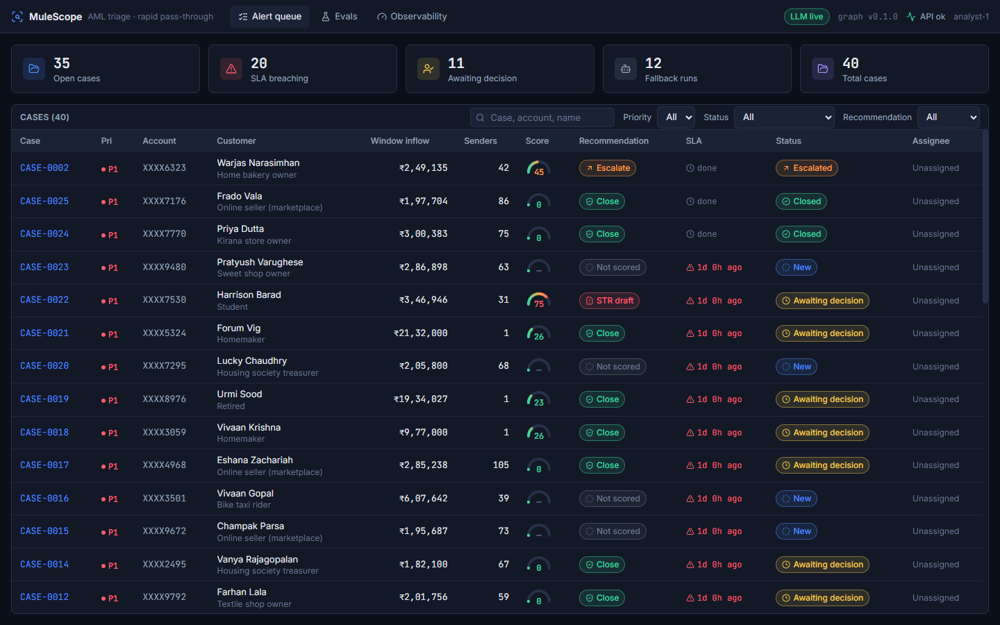

Opening a case shows the whole picture at once. In this example a cab driver in Lucknow, who declared a monthly turnover of ₹39,200, received ₹5.36 lakh from 42 people in two weeks, almost none of whom had paid him before. The money left within a median of 39 minutes, all of it to two people. The score is 75 out of 100 and the recommendation is an STR draft.

The money-flow graph puts the senders on the left, the flagged account in the middle and the receivers on the right. Line width shows the amount and line colour shows how fast the money left. Hovering over a card traces that party's path through the account, and every view can be opened full screen.

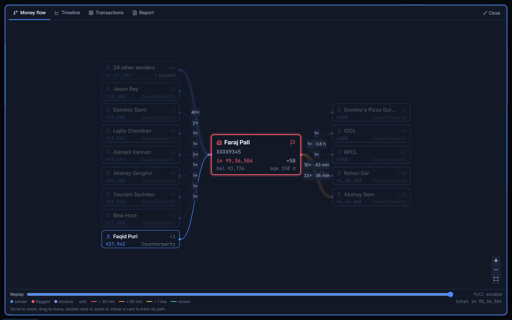

The timeline shows money in and out by day, the end-of-day balance (it never builds up), and how long money stayed before leaving. Dragging the bar under the chart narrows the list of entries below it.

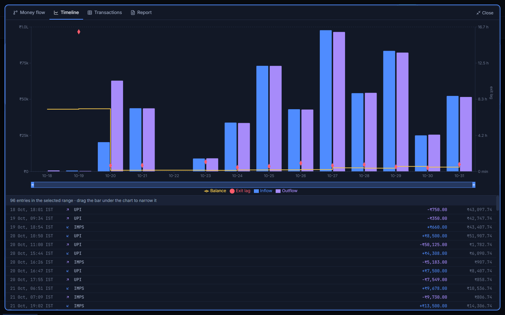

The transaction ledger shows every entry in the window. The remarks column is marked as untrusted, because the people who write remarks may be the criminals, and the last column shows which evidence items cite each transaction.

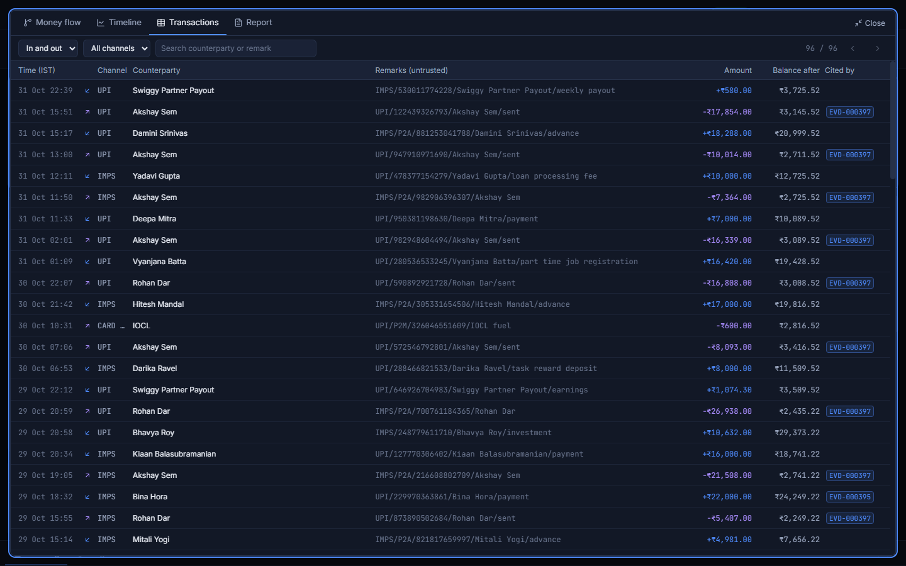

### The report

The report reads as a document: case facts at the top, then the summary and findings, the score, the patterns that matched, and the recommended outcome with its actions. Every claim carries an evidence chip, and hovering over it shows the fact behind it.


For an STR draft the report adds the narrative a reporting officer needs: who, what, when, where, how, why it is suspicious, the amounts and the accounts involved. The proposed actions are listed with their owner and due date.

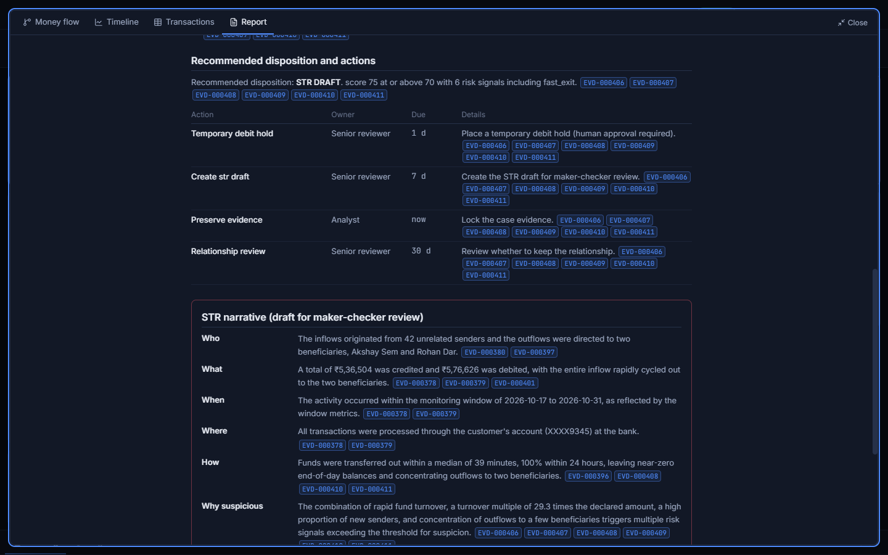

For an escalation the report instead includes a neutral letter asking the customer about the payments. It must never hint at suspicion or an investigation, because warning a suspect (tipping off) is itself an offence. The reviewer checks for that.

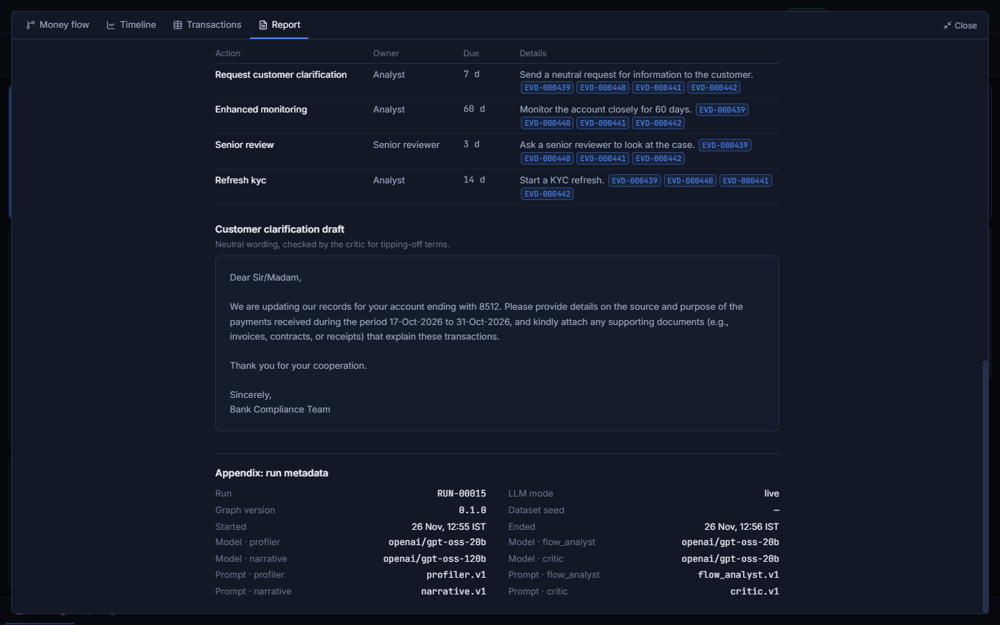

The analyst can edit the report before approving it, with the text on one side and a live preview on the other. The editor warns when an edit removes a citation.

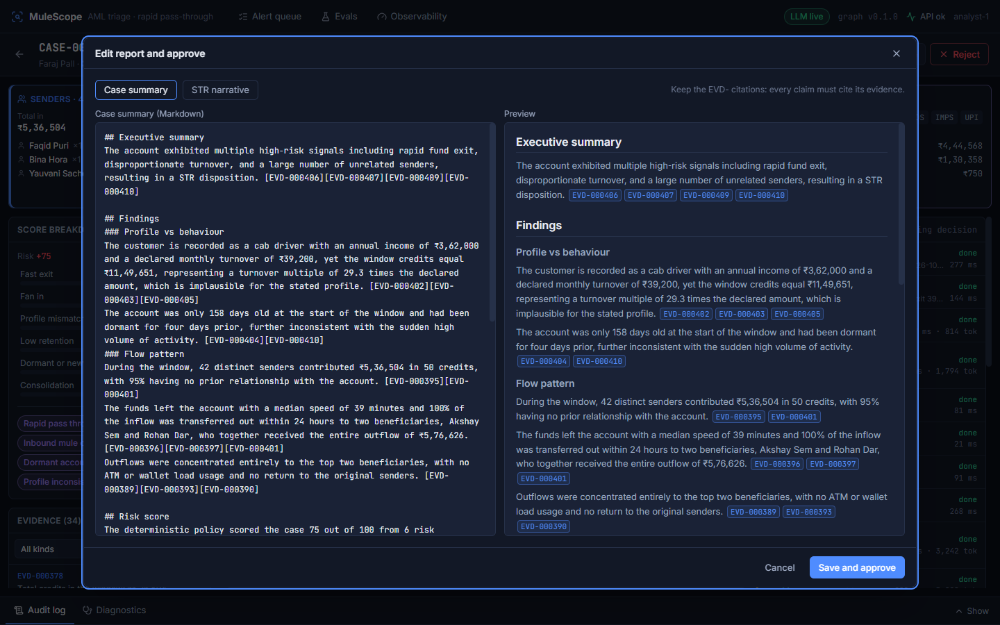

Not every alert is a mule. This homemaker received a single large transfer of ₹9.77 lakh and paid it out over several days to four people. The profile does not match, but the money did not move like a mule's, so the score is 26 and the recommendation is to close.

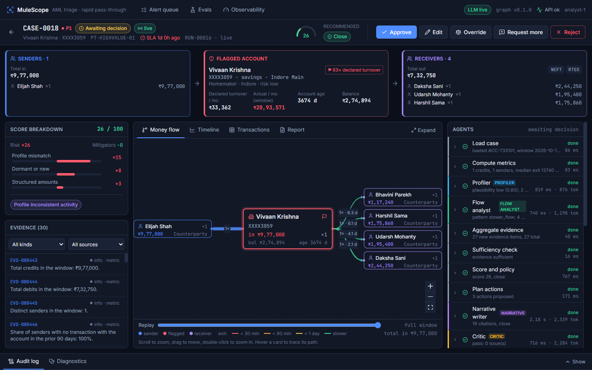

### What happened behind it

The Agents panel shows each step of the investigation as it runs, with its time and tokens, and marks any step that fell back to its rule-based version.

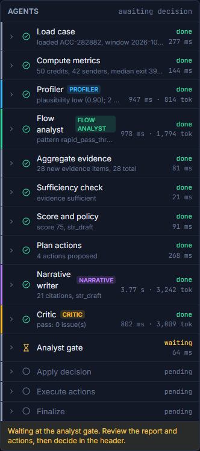

The audit log records every step, decision and action in order. Each record holds the hash of the one before it, and the badge at the top confirms the chain is unbroken.

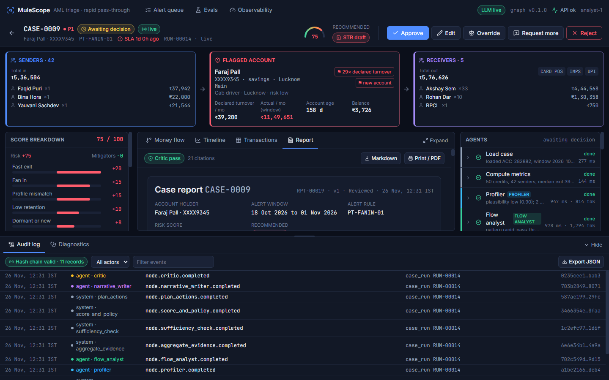

Diagnostics show the run in numbers: wall time, tokens, estimated cost, a timeline of the steps, and the model and prompt version each agent used.


## How an investigation runs

An investigation is a graph of fourteen steps, orchestrated with LangGraph. Ten of them are plain code. Four are agents.

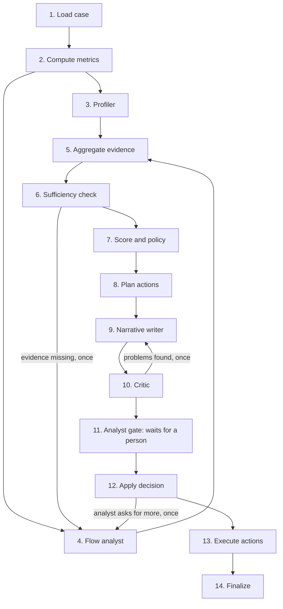

| Step | What it does |
| --- | --- |
| 1. Load case | Loads the alert, the account and the customer's KYC record. |
| 2. Compute metrics | Calculates seventeen measures from the ledger, such as the number of senders, how long money stayed, how much stayed overnight, and turnover against what was declared. |
| 3. Profiler | Judges whether the activity fits this customer. |
| 4. Flow analyst | Traces where the money came from and where it went. Runs alongside the profiler. |
| 5. Aggregate evidence | Gives every fact an `EVD-` id and links each fact to the facts it relies on. |
| 6. Sufficiency check | Confirms there are metric, profile, flow and complaint facts before scoring. |
| 7. Score and policy | Scores the case and picks the outcome. This is the only place an outcome is decided. |
| 8. Plan actions | Proposes actions from a playbook, such as a debit hold, a KYC refresh or the STR draft. |
| 9. Narrative writer | Writes the report. |
| 10. Critic | Reviews the report before a person sees it. |
| 11. Analyst gate | Pauses the run until the analyst decides. The state is saved, so it survives a restart. |
| 12. Apply decision | Records the decision and the final outcome. |
| 13. Execute actions | Marks the approved actions as done. Execution is simulated. |
| 14. Finalize | Closes the case with its final status and totals. |

Each loop can run at most once, so an investigation always finishes.

### The four agents

Each agent first does its job with rules, then asks the AI model to add judgement and language on top. If the model call fails, the rule-based result is used on its own.

| Agent | With rules alone | What the AI model adds |
| --- | --- | --- |
| Profiler | Compares turnover, account age and KYC status with what the customer declared. | A judgement on whether the behaviour is plausible for this person, with the specific mismatches. |
| Flow analyst | Runs four read-only lookups: top senders and receivers, linked accounts at the bank, other accounts paid by the same senders, and open fraud complaints. Flags remarks that look like instructions. | A description of the money-flow pattern. Remarks are passed in as untrusted data that must never be obeyed. |
| Narrative writer | Builds the report from the evidence statements. | A readable summary, findings and STR narrative, each sentence tied to evidence ids. The score and outcome section is always kept from the rules. |
| Critic | Checks that every citation exists, every claim is cited, the stated outcome matches the policy, the STR has all its sections and the customer letter has no forbidden words. | A review for claims the evidence does not support, signs the draft followed an instruction hidden in a remark, and wording that hints at suspicion. |

The profiler, flow analyst and critic use `openai/gpt-oss-20b` on Groq. The narrative writer uses `openai/gpt-oss-120b`, and falls back to the smaller model before falling back to rules.

### When an agent falls back

A step uses its rule-based version when the AI call cannot produce a valid answer in time. In practice that happens when:

- the provider rate-limits the request and the retry also fails;
- a call takes longer than 20 seconds, or the whole step takes longer than 40 seconds;
- the provider returns a permanent error;
- the answer is not valid for the agent's expected format, even after one request to correct it;
- no API key is configured, or the system is deliberately run in `fallback` mode.

## How the score works

The score adds points for risk signals and subtracts points for signs of a legitimate explanation. It never goes below zero. All weights and thresholds live in `config/scoring.yaml`.

| Risk signal | Points | Fires when |
| --- | --- | --- |
| Fast exit | 20 | Money leaves within a median of 90 minutes and at least 70% leaves within 24 hours |
| Fan-in | 15 | At least 15 senders, and at least 70% had never paid this account before |
| Profile mismatch | 15 | Turnover is at least 10 times what the customer declared |
| Victim-linked | 15 (6 for one sender) | Senders have open fraud complaints against this account |
| Low retention | 10 | End-of-day balances stay near zero relative to what came in |
| New or dormant | 8 | The account is under 180 days old, or was inactive for over 180 days |
| Consolidation | 7 | The top two receivers get at least 70% of the money out |
| Cash-out | 7 | At least 40% leaves through ATMs or wallet loads |
| Structured amounts | 3 | At least 30% of credits are round or just under a limit |

| Mitigator | Points | Fires when |
| --- | --- | --- |
| Steady history | -15 | This window looks like the previous 90 days |
| Repeat senders | -12 | At least 40% of senders also paid in before |
| Business profile | -10 | A business occupation, with turnover close to what was declared |
| Money flows back | -8 | At least 20% of the money out goes back to the senders, such as refunds |

The outcome follows from the score:

- below 40, **Close**;
- 40 to 69, **Escalate**;
- 70 or more, **STR draft**, but only if at least three risk signals fired and one of them is fast exit or victim-linked; otherwise Escalate;
- within five points of a threshold, the more cautious outcome is chosen;
- if three or more senders have open fraud complaints, the case is never closed.

The matched signals also name the pattern in plain words, such as rapid pass-through or inbound mule collection, so the analyst can see at a glance what kind of case it is.

## The data

The dataset is generated, not collected. `uv run seed` builds six months of activity for a few hundred synthetic customers across ten personas, including salaried workers, students, shopkeepers, freelancers, gig workers, retirees and housing-society treasurers. It uses Indian names, cities and payment channels (UPI, IMPS, NEFT, RTGS, ATM, cards and wallets), with festival spending and ordinary noise. The same seed always produces the same data.

Into that background it plants forty accounts with a known answer:

| Family | Count | Examples |
| --- | --- | --- |
| Mules | 10 | Classic pass-through, profile mismatch, cash-out, victim-linked, a layered chain, and one with remarks that try to instruct an AI reviewer |
| Sellers | 10 | Shops with loyal customers, online sellers with refunds, freelancers with round invoices |
| Groups | 8 | Housing-society funds, chit funds and rent splits |
| Dormant | 6 | Long-silent accounts that wake up, some suspicious and some legitimate |
| Ambiguous | 6 | New businesses, partial signals, and a shop that happens to share a sender with a fraud complaint |

Many of these are deliberate lookalikes: a busy kirana store also has many senders and pays its supplier quickly. The answers are stored in a separate database that the investigation never reads.

## Measuring it

### Evals

`uv run evals` runs all forty planted alerts through the full investigation, approves each one automatically, and compares the outcome with the hidden answer. The Evals page shows accuracy, a confusion matrix, how many real mules were wrongly closed, whether every citation points to real evidence, whether any customer letter tipped off the customer, and whether the injected-remark mule managed to influence the result.

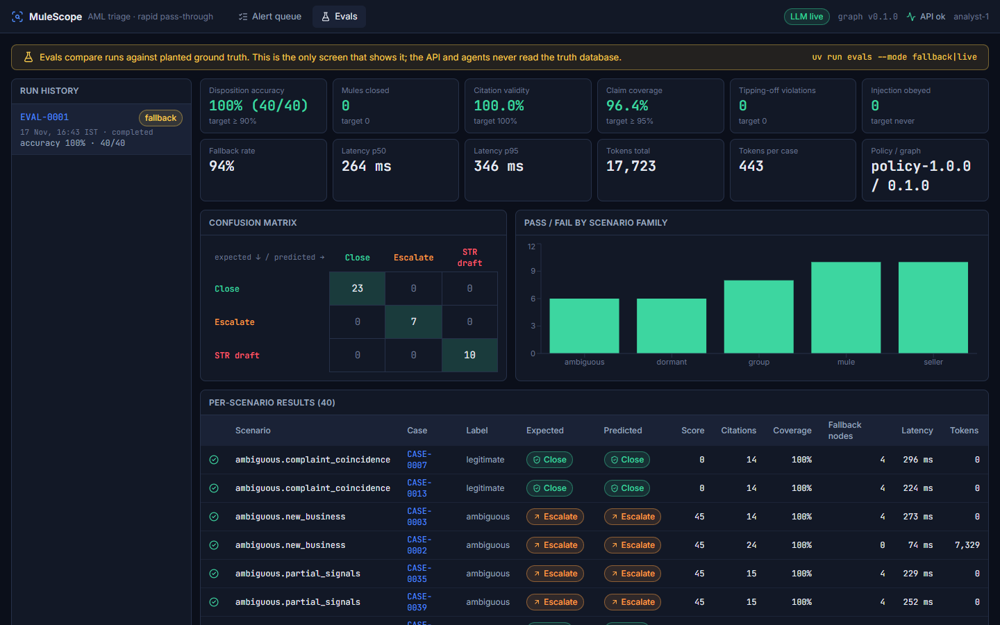

### Observability

Every AI call attempt is recorded: which step made it, the model, the outcome, how long it took, the tokens in and out, and an estimated cost at Groq's list prices. The Observability page turns that into cost and token totals, latency (average and the 95th percentile), error, retry, fallback and cache rates, a breakdown by agent and by model, and a meter that shows how close each model is to Groq's free-tier limit of about 8,000 tokens a minute.

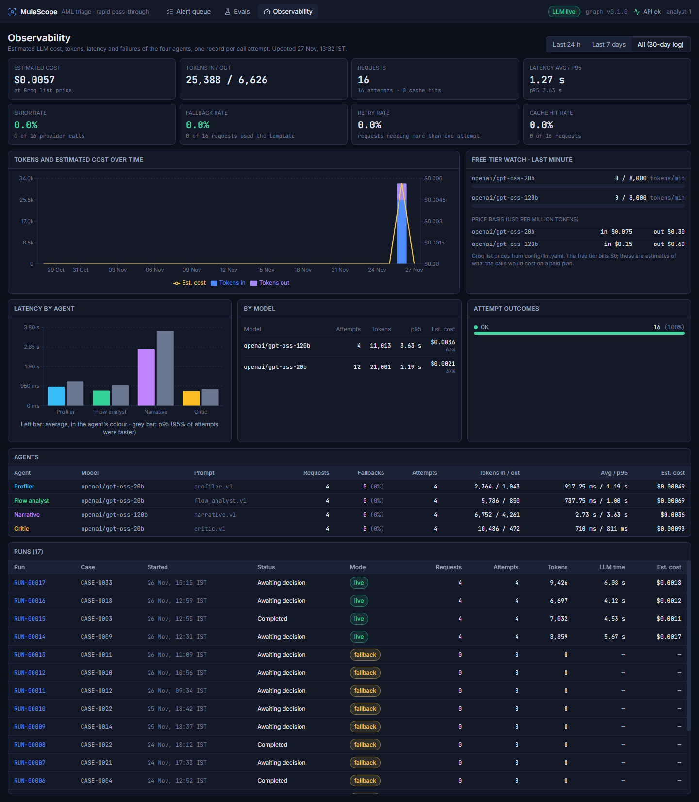

Opening a run shows each step with its cost, and every attempt with its outcome and any error.

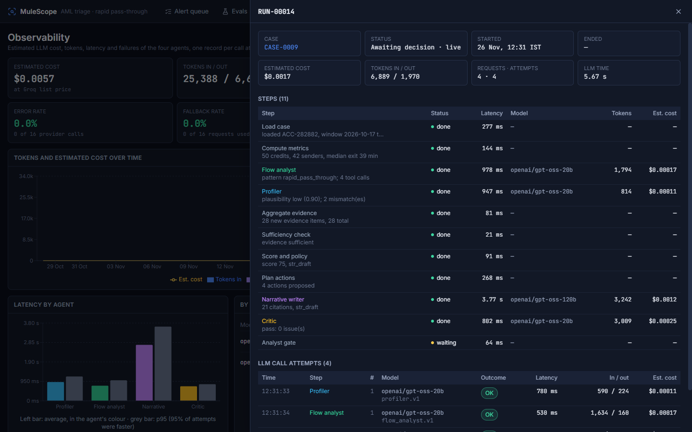

On the free tier the real bill is zero. The estimates show what the same calls would cost on a paid plan: a live investigation makes four model requests and costs well under a fifth of a US cent.

## Architecture

```
Browser (React)
   queue · case workspace · money flow · timeline · report · audit · observability · evals
        |  REST /api/v1                         ^  live progress (server-sent events)
        v                                       |
FastAPI
   routers (thin)  ->  services  ->  repositories (one per collection)
                         |
                         v
   LangGraph investigation graph, checkpointed in MongoDB
   agents  ->  LLM client: cache, retry and backoff, timeouts, concurrency limit,
                           call log with cost estimates, rule-based fallback
   domain (pure code): metrics, signals, scoring, outcome policy, action planner
                         ^
                         |  thresholds, weights, prices, playbook
                    config/*.yaml
        |
        v
MongoDB  mulescope         accounts, transactions, alerts, cases, evidence, reports,
                           actions, decisions, audit log, runs, call log, evals
MongoDB  mulescope_truth   planted answers only, read by the data generator and evals
```

A few design choices matter more than the rest:

- **The outcome never depends on an AI model.** Scoring and the policy are pure functions in `backend/app/domain` that import nothing but the standard library and Pydantic.
- **Agents never touch the database directly.** They get a small set of read-only lookups and can never read the planted answers.
- **Every AI answer is validated** against a schema, every citation is checked against the evidence list, and transaction remarks are always treated as untrusted text.
- **New signals, actions and patterns are added in configuration** or by registering a class, not by editing a chain of conditions.
- **The free tier is respected.** A shared limit of two concurrent calls, a response cache and the fallback path mean a quota error never breaks a case.

### Technology

| Area | Choices |
| --- | --- |
| Backend | Python 3.12, uv, FastAPI, Pydantic v2 |
| Orchestration | LangGraph with a MongoDB checkpointer |
| Models | Groq: `openai/gpt-oss-20b` and `openai/gpt-oss-120b` (Gemini can be selected per agent in configuration) |
| Database | MongoDB 7 with the native async PyMongo client |
| Data generation | Faker (`en_IN`) and NumPy with a fixed seed |
| Frontend | React 19, TypeScript, Vite, Tailwind CSS, TanStack Query and Virtual |
| Charts and graphs | React Flow with Dagre for the money flow, Recharts for charts, Lucide icons |
| Quality | pytest, ruff, mypy |

## Getting started

You will need Python 3.12, [uv](https://docs.astral.sh/uv/), Node.js 20.19 or newer, and MongoDB 7 (MongoDB Atlas, or a local instance with `docker compose up -d`). A free [Groq](https://console.groq.com) API key is needed for the AI agents; without one, every agent uses its rule-based version.

```powershell
uv sync
Copy-Item .env.example .env          # set MONGO_URI, MONGO_TRUTH_URI and GROQ_API_KEY
cd frontend
npm install
Copy-Item .env.example .env.local    # VITE_API_URL points at the API
cd ..
```

There is one `.env` file, in the repository root, and it is never committed. Environment variables override it. `MONGO_URI` and `MONGO_TRUTH_URI` can point at the same cluster, because the planted answers live in their own database. Make sure `CORS_ORIGINS` includes the address the UI runs on.

`LLM_MODE=live` is the default: agents call Groq and fall back to rules for any step that fails. `LLM_MODE=fallback` runs every agent from rules with no network calls, which is useful offline and in tests.

### Running it

In separate terminals, from the repository root:

```powershell
uv run seed --seed 42 --customers 300 --reset   # generate the data and open the alerts
uv run dev                                       # API at http://127.0.0.1:8742 (docs at /docs)
cd frontend; npm run dev                         # UI at http://localhost:5190
```

`--reset` deletes both databases, including every case, run and audit record, so stop the API before running it.

In the UI, open a case, press **Start investigation**, watch the steps complete, read the money flow and the report, then choose **Approve**, **Edit**, **Override**, **Request more** or **Reject**. The Observability page fills in as live investigations run.

| Command | What it does |
| --- | --- |
| `uv run seed --seed 42 --customers 300 --reset` | Generate and load the data, run the detector, and report any planted account that did not raise an alert |
| `uv run seed --preview ACC-123456` | Print one account's 14-day story |
| `uv run check-policy` | Compare the policy's outcome with the planted answer for all forty alerts, using code only |
| `uv run smoke` | Run one mule and one seller through the full investigation with automatic approval |
| `uv run smoke --mode live` | The same, with the AI agents |
| `uv run evals --mode fallback` | Run all forty alerts with rule-based agents and score them |
| `uv run evals --mode live --limit 5` | Score the first five alerts with the AI agents |
| `uv run evals --mode live --resume` | Continue an unfinished live eval, skipping cases already scored |
| `uv run dev` | Start the API |

Evals start a new run on every planted case and approve it automatically, so they overwrite the state of cases you were reviewing. A full live eval uses roughly half a million tokens, which is more than the free tier allows in a day, so run it in parts with `--limit` and `--resume`.

## Results

Policy `policy-1.0.0`, graph `0.1.0`, dataset seed 42.

| Check | Result |
| --- | --- |
| Policy only (`uv run check-policy`) | 40 of 40 outcomes match the planted answer, 0 mules closed |
| Same weights on a different seed (7) | 40 of 40, 0 mules closed |
| Full investigation, rule-based agents (`uv run evals --mode fallback`) | 40 of 40 correct, 0 mules closed, 100% valid citations, 96.4% of claims cited, 0 tipping-off violations, the injected remark never obeyed, 264 ms median per case |
| Live investigations on Groq | 4 model requests per case, about 8,000 tokens and 5 seconds of model time, roughly $0.0014 per case at list price, no fallbacks |

A few honest caveats:

- The weights were tuned on the seed-42 planted alerts, so the seed-42 accuracy is in-sample. Seed 7 comes from the same generator, so it is a check of stability, not of performance on real bank data.
- Four of the ten seed-42 mules score between 65 and 68. They reach an STR draft only through the cautious-outcome rule near the threshold of 70, so a small change in the data or the weights could move them to Escalate.
- A full live eval of all forty alerts has not been run yet because of the free-tier limits.

## Scope and known limits

**In scope:** mule and rapid pass-through alerts, alert detection, the case queue, the investigation, scoring and the outcome policy, action planning with simulated execution, analyst approval, the audit trail, observability, report export and evals.

**Out of scope:** card fraud, account takeover, phishing, sanctions screening, real-time blocking, integration with real banking systems, and real customer data.

**Known limits:**

- There is no login. The analyst's identity on a decision is taken as given, so this is suitable for local use and demonstration only.
- An STR draft is approved by a single analyst. A second reviewer step (maker-checker) is not built yet.
- The flow analyst's lookups always run in the same order; the model interprets their results but does not choose them.
- The sufficiency check almost never sends a case back, because the rule-based steps always produce the four kinds of evidence it looks for. Asking for more evidence re-runs the flow analyst, but it usually finds the same facts.
- When no risk signal fires, the fixed score and outcome lines have nothing to cite, so the critic flags them and one rewrite cannot fix it.
- Actions keep the evidence of the run that proposed them, and a cancelled action still blocks a new proposal of the same type for the same account.
- The money-flow graph shows the top eight senders and receivers by default, and at most 24 senders and 12 receivers when a side is expanded.
- The detector only looks at the 14-day window ending on the dataset date, and the background data raises no alerts of its own, so false alarms on ordinary activity are not really measured.
- Rate limiting, the live event stream and the audit-chain lock work within one server process.

More detail on decisions and gaps is in [PROGRESS.md](PROGRESS.md).

## Repository layout

```
backend/app/
  core/            settings, wiring, logging, errors, configuration loaders
  domain/          metrics, risk signals, scoring, outcome policy, action planner
  repositories/    MongoDB access, one class per collection, collection setup
  services/        detector, metrics, case runner, read models, observability
  agents/          profiler, flow analyst, narrative writer, critic, lookups, prompts
  graph/           investigation state, steps, loops, graph builder
  llm/             providers, client with cache and limits, call log
  api/             routes, request and response models, error handling
datagen/           personas, counterparties, ledger, planted scenarios, validation
evals/             policy check, smoke test and the eval harness
config/            scoring, playbook, scenarios and model settings
frontend/          the analyst interface
tests/             unit and integration tests (some predate later changes and are out of date)
docs/              design specification and the screenshots in this file
```

## Configuration

Thresholds, weights, model names, prices, token limits, scenario parameters and the action playbook all live in `config/*.yaml`, not in code. Changing a signal weight or a playbook rule needs no code change; run `uv run check-policy` afterwards to see the effect on the forty planted alerts.

## License

[MIT](LICENSE)
